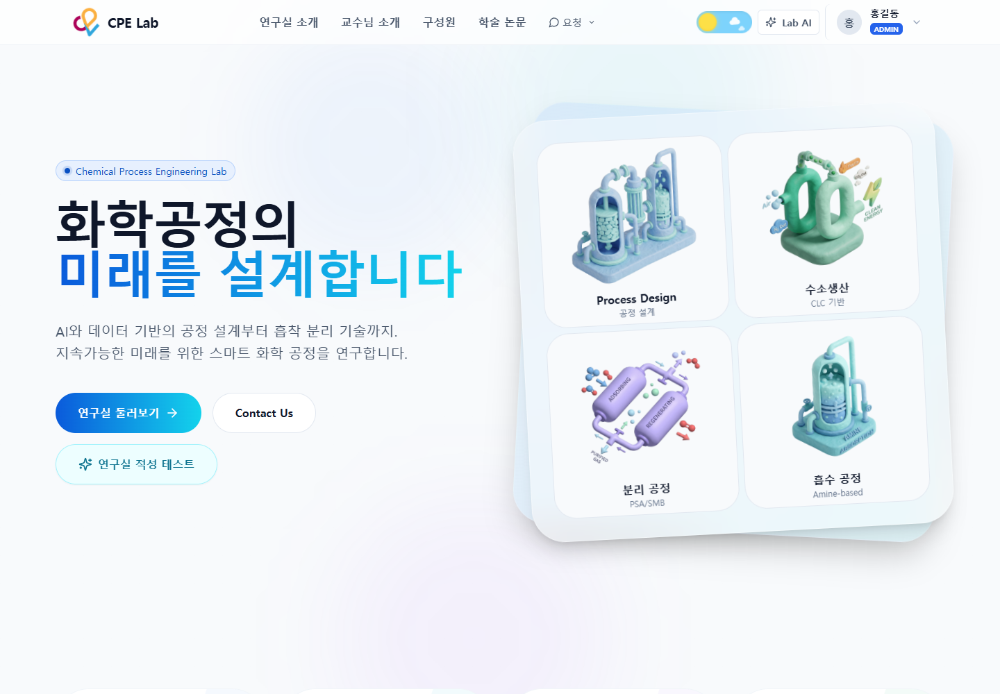
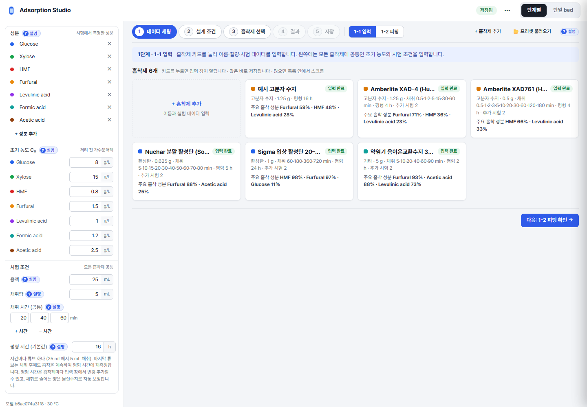
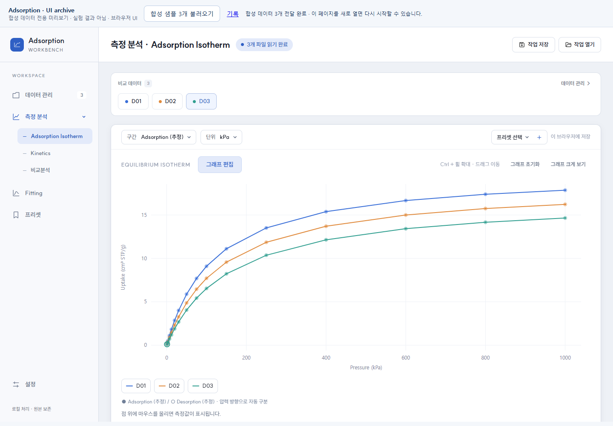
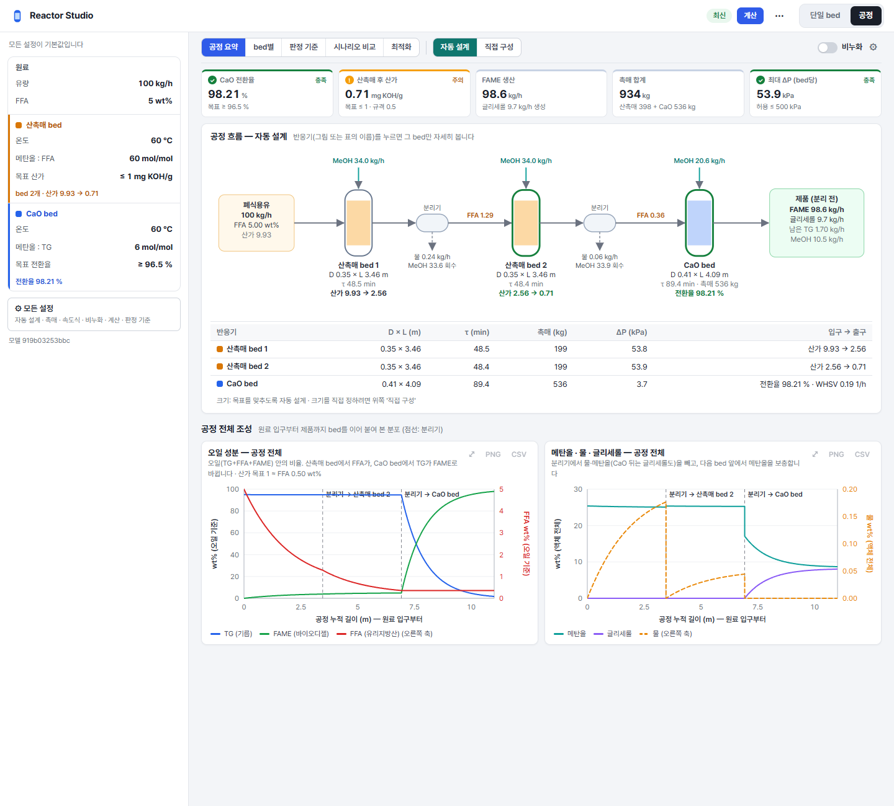

# UI — 태그별

<!-- Generated by tools/build_catalog.py; edit entry metadata instead. -->

## dark

### My UI

| Preview | UI · ID | 유형 | 태그 | Framework / library | 상태 |
| --- | --- | --- | --- | --- | --- |
|  | [LabWeb · Full Site](../my-ui/labweb/full-site/README.md) my--labweb--full-site | full-layout, sidebar-navigation, table, other | light, dark, desktop, responsive, file-browser, drag-drop, synthetic-preview | nextjs, react, tailwindcss, lucide-react | draft |

### Reference UI

아직 등록된 UI가 없습니다.

## desktop

### My UI

| Preview | UI · ID | 유형 | 태그 | Framework / library | 상태 |
| --- | --- | --- | --- | --- | --- |
|  | [Adsorption Studio · Full Studio](../my-ui/adsorption-studio/full-studio/README.md) my--adsorption-studio--full-studio | full-layout, dashboard, data-visualization, form-input, modal-dialog, settings, table | light, desktop, scientific, step-wizard, help-popover, flowsheet, synthetic-preview | vanilla-js, svg, python-http-server, pywebview | draft |
|  | [Adsorption Workbench · Full UI](../my-ui/adsorption-workbench/full-workbench/README.md) my--adsorption-workbench--full-workbench | full-layout, sidebar-navigation, data-visualization, modal-dialog, table, settings, form-input | light, desktop, scientific, graph-editor, drag-drop, local-storage, synthetic-preview | vanilla-js, react, bklit-ui, motion, visx | draft |
|  | [LabWeb · Full Site](../my-ui/labweb/full-site/README.md) my--labweb--full-site | full-layout, sidebar-navigation, table, other | light, dark, desktop, responsive, file-browser, drag-drop, synthetic-preview | nextjs, react, tailwindcss, lucide-react | draft |
|  | [Reactor Studio · Full Studio](../my-ui/reactor-studio/full-studio/README.md) my--reactor-studio--full-studio | full-layout, dashboard, data-visualization, form-input, settings, table | light, desktop, scientific, property-sheet, flowsheet, local-storage, synthetic-preview | vanilla-js, svg, python-http-server, pywebview | draft |

### Reference UI

아직 등록된 UI가 없습니다.

## drag-drop

### My UI

| Preview | UI · ID | 유형 | 태그 | Framework / library | 상태 |
| --- | --- | --- | --- | --- | --- |
|  | [Adsorption Workbench · Full UI](../my-ui/adsorption-workbench/full-workbench/README.md) my--adsorption-workbench--full-workbench | full-layout, sidebar-navigation, data-visualization, modal-dialog, table, settings, form-input | light, desktop, scientific, graph-editor, drag-drop, local-storage, synthetic-preview | vanilla-js, react, bklit-ui, motion, visx | draft |
|  | [LabWeb · Full Site](../my-ui/labweb/full-site/README.md) my--labweb--full-site | full-layout, sidebar-navigation, table, other | light, dark, desktop, responsive, file-browser, drag-drop, synthetic-preview | nextjs, react, tailwindcss, lucide-react | draft |

### Reference UI

아직 등록된 UI가 없습니다.

## file-browser

### My UI

| Preview | UI · ID | 유형 | 태그 | Framework / library | 상태 |
| --- | --- | --- | --- | --- | --- |
|  | [LabWeb · Full Site](../my-ui/labweb/full-site/README.md) my--labweb--full-site | full-layout, sidebar-navigation, table, other | light, dark, desktop, responsive, file-browser, drag-drop, synthetic-preview | nextjs, react, tailwindcss, lucide-react | draft |

### Reference UI

아직 등록된 UI가 없습니다.

## flowsheet

### My UI

| Preview | UI · ID | 유형 | 태그 | Framework / library | 상태 |
| --- | --- | --- | --- | --- | --- |
|  | [Adsorption Studio · Full Studio](../my-ui/adsorption-studio/full-studio/README.md) my--adsorption-studio--full-studio | full-layout, dashboard, data-visualization, form-input, modal-dialog, settings, table | light, desktop, scientific, step-wizard, help-popover, flowsheet, synthetic-preview | vanilla-js, svg, python-http-server, pywebview | draft |
|  | [Reactor Studio · Full Studio](../my-ui/reactor-studio/full-studio/README.md) my--reactor-studio--full-studio | full-layout, dashboard, data-visualization, form-input, settings, table | light, desktop, scientific, property-sheet, flowsheet, local-storage, synthetic-preview | vanilla-js, svg, python-http-server, pywebview | draft |

### Reference UI

아직 등록된 UI가 없습니다.

## graph-editor

### My UI

| Preview | UI · ID | 유형 | 태그 | Framework / library | 상태 |
| --- | --- | --- | --- | --- | --- |
|  | [Adsorption Workbench · Full UI](../my-ui/adsorption-workbench/full-workbench/README.md) my--adsorption-workbench--full-workbench | full-layout, sidebar-navigation, data-visualization, modal-dialog, table, settings, form-input | light, desktop, scientific, graph-editor, drag-drop, local-storage, synthetic-preview | vanilla-js, react, bklit-ui, motion, visx | draft |

### Reference UI

아직 등록된 UI가 없습니다.

## help-popover

### My UI

| Preview | UI · ID | 유형 | 태그 | Framework / library | 상태 |
| --- | --- | --- | --- | --- | --- |
|  | [Adsorption Studio · Full Studio](../my-ui/adsorption-studio/full-studio/README.md) my--adsorption-studio--full-studio | full-layout, dashboard, data-visualization, form-input, modal-dialog, settings, table | light, desktop, scientific, step-wizard, help-popover, flowsheet, synthetic-preview | vanilla-js, svg, python-http-server, pywebview | draft |

### Reference UI

아직 등록된 UI가 없습니다.

## light

### My UI

| Preview | UI · ID | 유형 | 태그 | Framework / library | 상태 |
| --- | --- | --- | --- | --- | --- |
|  | [Adsorption Studio · Full Studio](../my-ui/adsorption-studio/full-studio/README.md) my--adsorption-studio--full-studio | full-layout, dashboard, data-visualization, form-input, modal-dialog, settings, table | light, desktop, scientific, step-wizard, help-popover, flowsheet, synthetic-preview | vanilla-js, svg, python-http-server, pywebview | draft |
|  | [Adsorption Workbench · Full UI](../my-ui/adsorption-workbench/full-workbench/README.md) my--adsorption-workbench--full-workbench | full-layout, sidebar-navigation, data-visualization, modal-dialog, table, settings, form-input | light, desktop, scientific, graph-editor, drag-drop, local-storage, synthetic-preview | vanilla-js, react, bklit-ui, motion, visx | draft |
|  | [LabWeb · Full Site](../my-ui/labweb/full-site/README.md) my--labweb--full-site | full-layout, sidebar-navigation, table, other | light, dark, desktop, responsive, file-browser, drag-drop, synthetic-preview | nextjs, react, tailwindcss, lucide-react | draft |
|  | [Reactor Studio · Full Studio](../my-ui/reactor-studio/full-studio/README.md) my--reactor-studio--full-studio | full-layout, dashboard, data-visualization, form-input, settings, table | light, desktop, scientific, property-sheet, flowsheet, local-storage, synthetic-preview | vanilla-js, svg, python-http-server, pywebview | draft |

### Reference UI

아직 등록된 UI가 없습니다.

## local-storage

### My UI

| Preview | UI · ID | 유형 | 태그 | Framework / library | 상태 |
| --- | --- | --- | --- | --- | --- |
|  | [Adsorption Workbench · Full UI](../my-ui/adsorption-workbench/full-workbench/README.md) my--adsorption-workbench--full-workbench | full-layout, sidebar-navigation, data-visualization, modal-dialog, table, settings, form-input | light, desktop, scientific, graph-editor, drag-drop, local-storage, synthetic-preview | vanilla-js, react, bklit-ui, motion, visx | draft |
|  | [Reactor Studio · Full Studio](../my-ui/reactor-studio/full-studio/README.md) my--reactor-studio--full-studio | full-layout, dashboard, data-visualization, form-input, settings, table | light, desktop, scientific, property-sheet, flowsheet, local-storage, synthetic-preview | vanilla-js, svg, python-http-server, pywebview | draft |

### Reference UI

아직 등록된 UI가 없습니다.

## property-sheet

### My UI

| Preview | UI · ID | 유형 | 태그 | Framework / library | 상태 |
| --- | --- | --- | --- | --- | --- |
|  | [Reactor Studio · Full Studio](../my-ui/reactor-studio/full-studio/README.md) my--reactor-studio--full-studio | full-layout, dashboard, data-visualization, form-input, settings, table | light, desktop, scientific, property-sheet, flowsheet, local-storage, synthetic-preview | vanilla-js, svg, python-http-server, pywebview | draft |

### Reference UI

아직 등록된 UI가 없습니다.

## responsive

### My UI

| Preview | UI · ID | 유형 | 태그 | Framework / library | 상태 |
| --- | --- | --- | --- | --- | --- |
|  | [LabWeb · Full Site](../my-ui/labweb/full-site/README.md) my--labweb--full-site | full-layout, sidebar-navigation, table, other | light, dark, desktop, responsive, file-browser, drag-drop, synthetic-preview | nextjs, react, tailwindcss, lucide-react | draft |

### Reference UI

아직 등록된 UI가 없습니다.

## scientific

### My UI

| Preview | UI · ID | 유형 | 태그 | Framework / library | 상태 |
| --- | --- | --- | --- | --- | --- |
|  | [Adsorption Studio · Full Studio](../my-ui/adsorption-studio/full-studio/README.md) my--adsorption-studio--full-studio | full-layout, dashboard, data-visualization, form-input, modal-dialog, settings, table | light, desktop, scientific, step-wizard, help-popover, flowsheet, synthetic-preview | vanilla-js, svg, python-http-server, pywebview | draft |
|  | [Adsorption Workbench · Full UI](../my-ui/adsorption-workbench/full-workbench/README.md) my--adsorption-workbench--full-workbench | full-layout, sidebar-navigation, data-visualization, modal-dialog, table, settings, form-input | light, desktop, scientific, graph-editor, drag-drop, local-storage, synthetic-preview | vanilla-js, react, bklit-ui, motion, visx | draft |
|  | [Reactor Studio · Full Studio](../my-ui/reactor-studio/full-studio/README.md) my--reactor-studio--full-studio | full-layout, dashboard, data-visualization, form-input, settings, table | light, desktop, scientific, property-sheet, flowsheet, local-storage, synthetic-preview | vanilla-js, svg, python-http-server, pywebview | draft |

### Reference UI

아직 등록된 UI가 없습니다.

## step-wizard

### My UI

| Preview | UI · ID | 유형 | 태그 | Framework / library | 상태 |
| --- | --- | --- | --- | --- | --- |
|  | [Adsorption Studio · Full Studio](../my-ui/adsorption-studio/full-studio/README.md) my--adsorption-studio--full-studio | full-layout, dashboard, data-visualization, form-input, modal-dialog, settings, table | light, desktop, scientific, step-wizard, help-popover, flowsheet, synthetic-preview | vanilla-js, svg, python-http-server, pywebview | draft |

### Reference UI

아직 등록된 UI가 없습니다.

## synthetic-preview

### My UI

| Preview | UI · ID | 유형 | 태그 | Framework / library | 상태 |
| --- | --- | --- | --- | --- | --- |
|  | [Adsorption Studio · Full Studio](../my-ui/adsorption-studio/full-studio/README.md) my--adsorption-studio--full-studio | full-layout, dashboard, data-visualization, form-input, modal-dialog, settings, table | light, desktop, scientific, step-wizard, help-popover, flowsheet, synthetic-preview | vanilla-js, svg, python-http-server, pywebview | draft |
|  | [Adsorption Workbench · Full UI](../my-ui/adsorption-workbench/full-workbench/README.md) my--adsorption-workbench--full-workbench | full-layout, sidebar-navigation, data-visualization, modal-dialog, table, settings, form-input | light, desktop, scientific, graph-editor, drag-drop, local-storage, synthetic-preview | vanilla-js, react, bklit-ui, motion, visx | draft |
|  | [LabWeb · Full Site](../my-ui/labweb/full-site/README.md) my--labweb--full-site | full-layout, sidebar-navigation, table, other | light, dark, desktop, responsive, file-browser, drag-drop, synthetic-preview | nextjs, react, tailwindcss, lucide-react | draft |
|  | [Reactor Studio · Full Studio](../my-ui/reactor-studio/full-studio/README.md) my--reactor-studio--full-studio | full-layout, dashboard, data-visualization, form-input, settings, table | light, desktop, scientific, property-sheet, flowsheet, local-storage, synthetic-preview | vanilla-js, svg, python-http-server, pywebview | draft |

### Reference UI

아직 등록된 UI가 없습니다.
