# Adsorption Studio · Full Studio

목질계 묽은산 가수분해액에서 발효 저해물질을 흡착으로 제거하고 당은 남기는 처리(회분 교반 탱크 또는 packed bed 컬럼)를 설계하는 화면입니다. 흡착제 시험 데이터 입력부터 피팅, 흡착제 비교, 투입량·bed 크기 결과, 보고서 저장까지 **5단계 안내**로 이어지고, `단일 bed` 모드에서는 같은 계산을 Reactor Studio식 전체 화면으로 봅니다.
**실제 Adsorption Studio를 실행해 캡처했습니다. `예시 고분자 수지`는 프로그램이 만든 가상 데이터이고, 나머지 5개 흡착제는 프로그램에 들어 있는 문헌 프리셋(논문 값으로 만든 예시)입니다. 실험 측정값이 아닙니다.**


## 보관 정보

| 항목 | 내용 |
| --- | --- |
| 프로그램 / 작성자 | Adsorption Studio / sunghail |
| 원본 프로젝트 | 비공개 로컬 프로젝트 (Git 저장소 아님) |
| 바탕 | [Reactor Studio · Full Studio](../../reactor-studio/full-studio/README.md)의 화면 구조·스타일을 이어받아 흡착용으로 고침 |
| 기준 | local snapshot 2026-10-28, 모델 버전 `b6ac074a31f8`(모델 파일 해시 앞 12자리, 화면 왼쪽 아래 표시) |
| 유형 | Full Layout, Dashboard, Data Visualization, Form / Input, Modal / Dialog, Settings, Table |
| 소스 범위 | 웹 UI 전체(`reactor_studio/web`, 29개 파일). Python 계산 서버·흡착 모델·exe 포장·문헌 프리셋 JSON은 미포함 |
| 상태 | draft: 화면 확인 완료, 소스는 backend가 있어야 실행됨 |
| 원본 대조 | [source-manifest.json](source-manifest.json): 파일별 크기와 SHA-256 |
| capture | 2026-10-28 · Google Chrome 155.0.8059.82 (Playwright 1.52.0, headless) · 1440×1000 · DPR 1 · light · ko-KR. 08번만 전체 페이지(1440×1814) |
| 데이터 | 프로그램 예시 프로젝트(성분 7개, 초기 농도 Glucose 8 · Xylose 15 · HMF 0.8 · Furfural 1.5 · Levulinic 1 · Formic 1.2 · Acetic 2.5 g/L, `예시 고분자 수지`) + 내장 문헌 프리셋 5개. 2단계는 컬럼, 목표 HMF·Furfural ≥ 90 %, 당 감소율 ≤ 15 %, 3단계에서 추천 1순위 선택 |

## 실제 화면

| 1단계 · 데이터 세팅 (흡착제 카드 6개) | 흡착제 프리셋 (문헌 표시) |
| --- | --- |
|  | 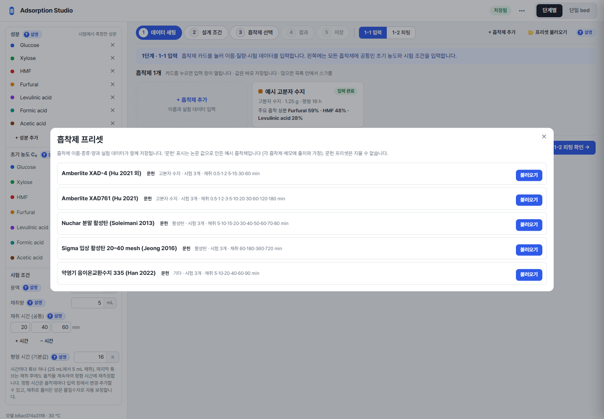 |

| 흡착제 입력 창 (채취 시간별 농도 · 평형 측정) | `? 설명` 위젯 (초기 농도 단위 환산) |
| --- | --- |
| 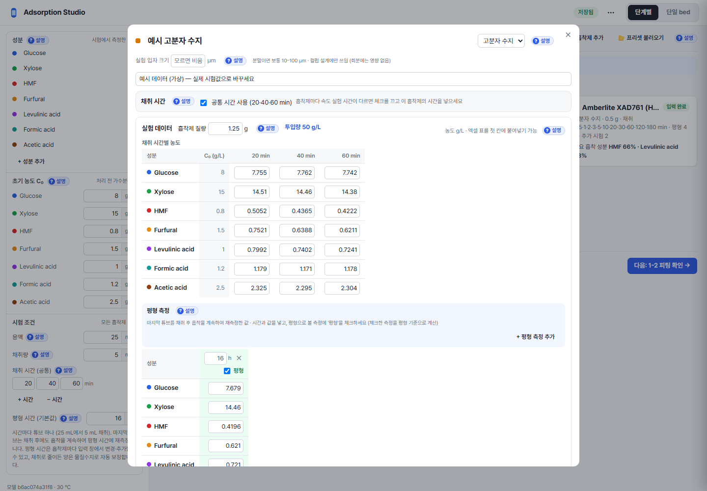 | 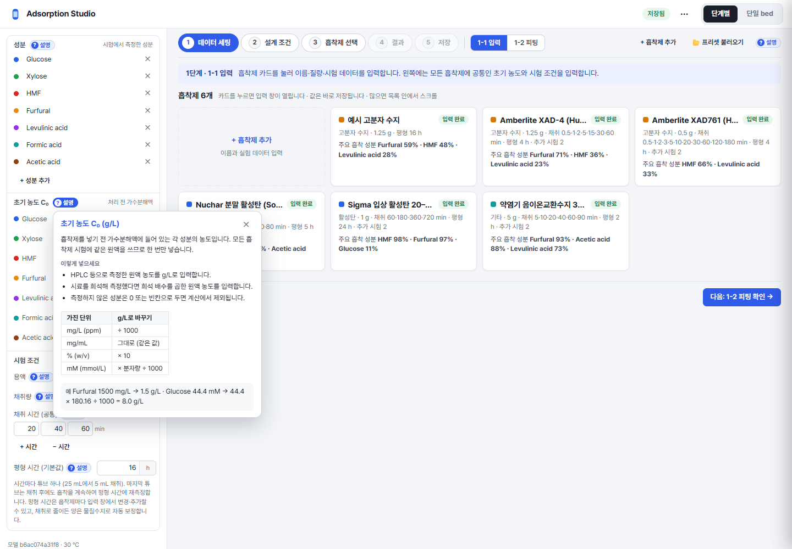 |

| 1-2 피팅 (속도 곡선 · 한눈 비교) | 2단계 · 설계 조건 (처리 방식 · 제거/보존) |
| --- | --- |
| 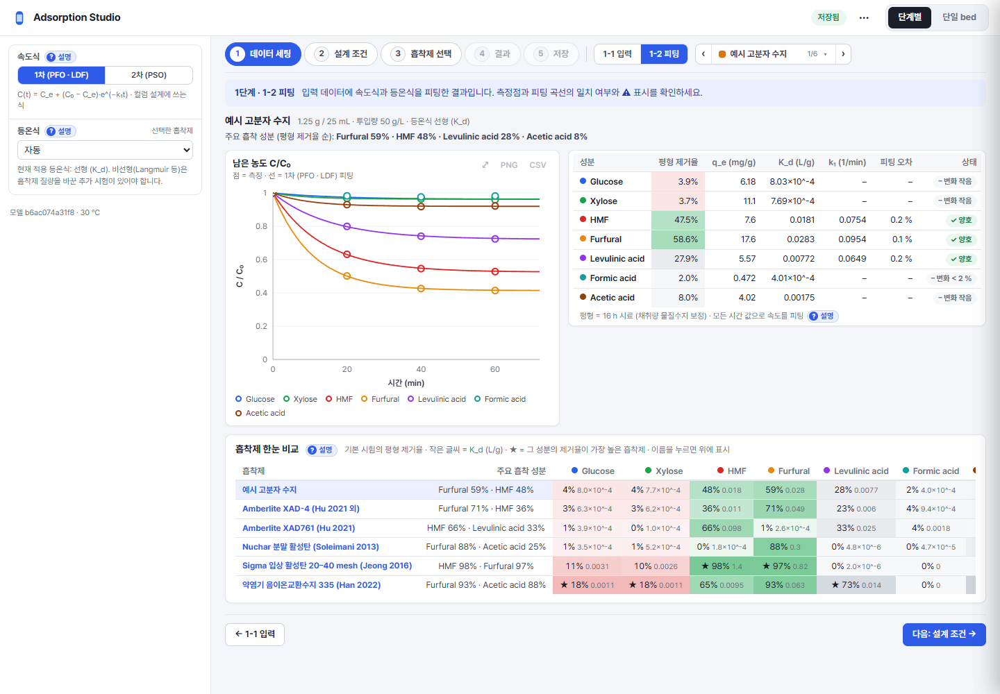 | 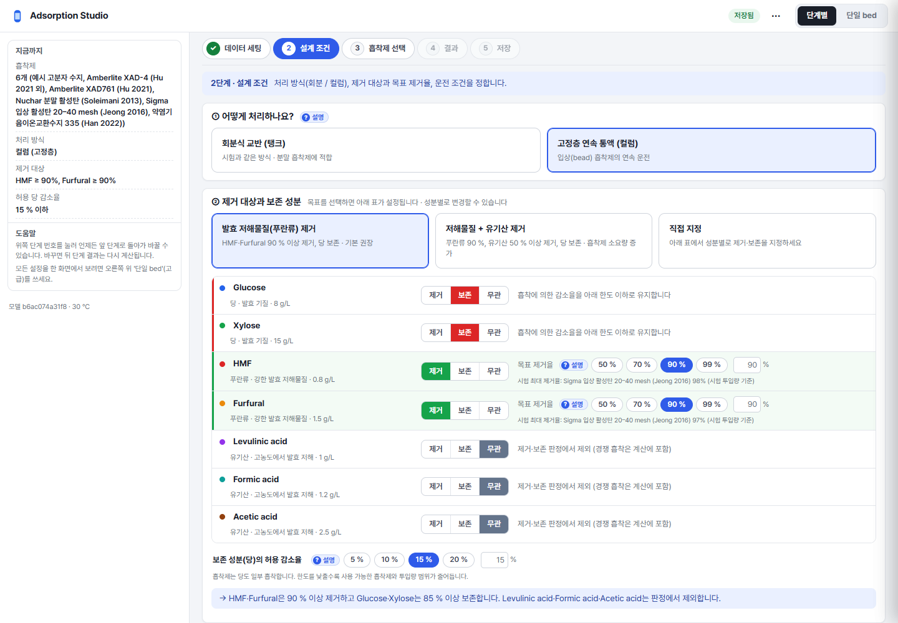 |

| 3단계 · 흡착제 선택 (bed 순위) | 5단계 · 저장 |
| --- | --- |
| 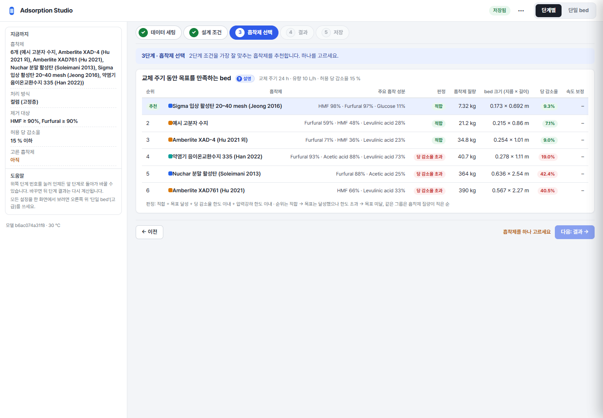 | 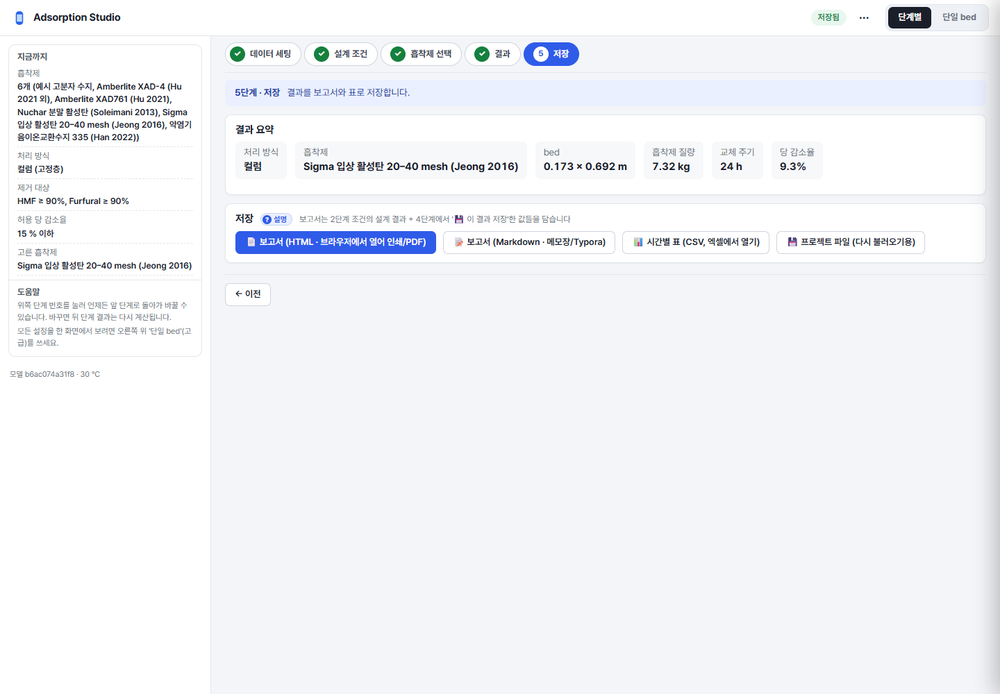 |

| 단일 bed · 흡착제 비교 | 단일 bed · 위치별 z |
| --- | --- |
| 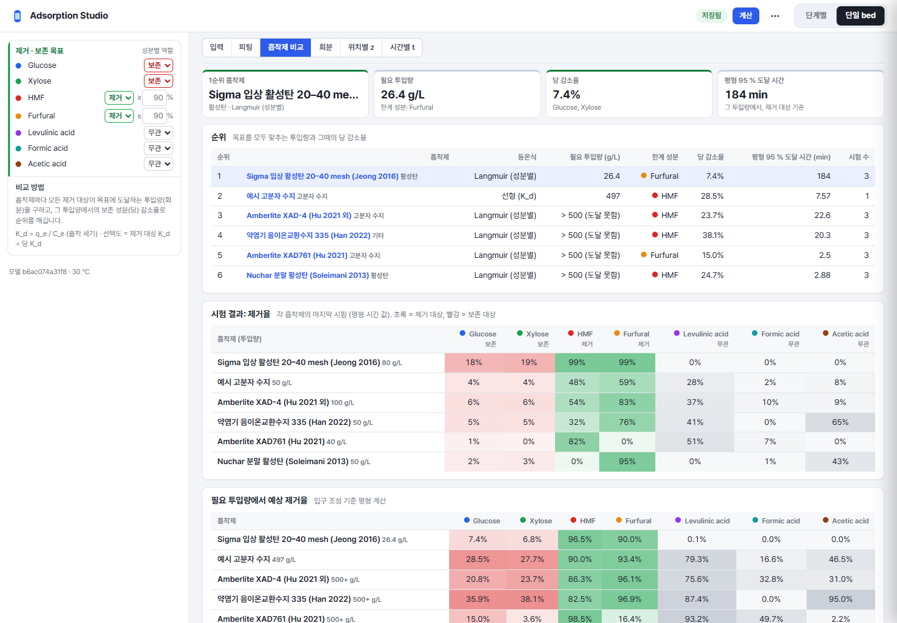 | 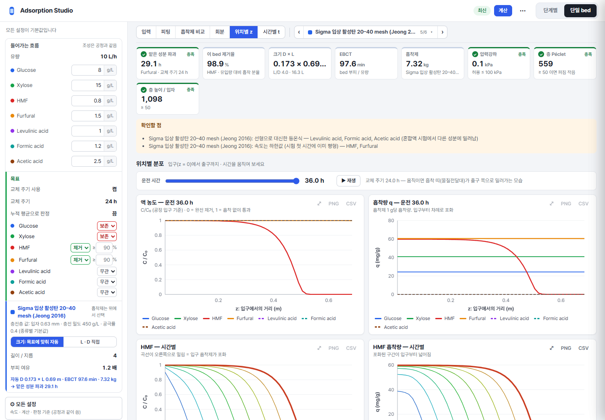 |

| 단일 bed · 시간별 t (파과곡선) | 공정 요약 (흐름도) |
| --- | --- |
| 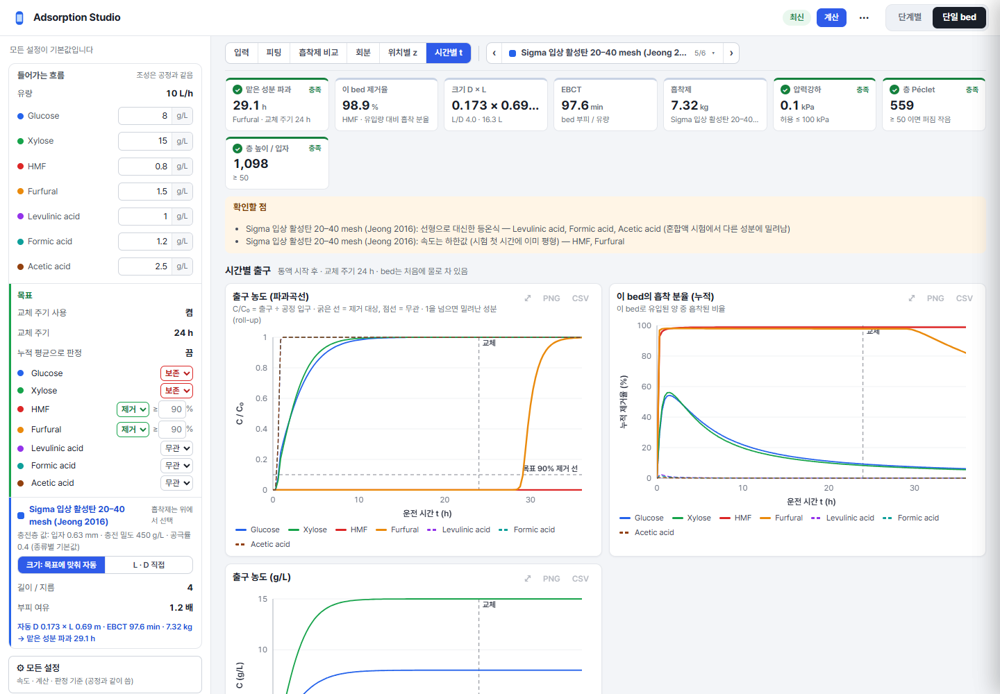 | 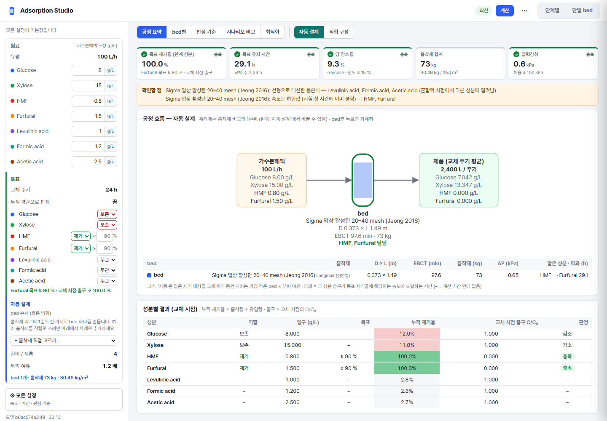 |

[4단계 · 결과 (전체 페이지)](screenshots/08-guide-result.png) · [⚙ 모든 설정 서랍](screenshots/14-settings.png)

## 주요 기능 · 설계 의도

- **5단계 안내:** 흡착을 잘 모르는 사람도 순서대로 따라가게 단계를 나눴습니다. 1단계는 `1-1 입력`과 `1-2 피팅` 두 부분이고, 각 단계 위에는 "여기서 할 일" 한 줄, 아래에는 `← 이전 / 다음 →`. 빠진 입력이 있으면 다음 버튼을 막고 이유를 옆에 적습니다. 왼쪽 패널은 단계에 따라 성분·초기 농도·시험 조건 입력, 피팅 설정, "지금까지" 요약으로 바뀝니다.
- **흡착제 카드:** 흡착제마다 종류·질량·채취 시간·평형 시간과 "주요 흡착 성분 (평형 제거율)"을 카드에 요약합니다. 카드가 많아지면 목록 안에서 스크롤합니다. 카드를 누르면 입력 창이 열립니다.
- **입력 창:** 채취 시간별 농도 표(엑셀 표를 첫 칸에 붙여넣기 가능), 흡착제마다 다른 채취 시간(`공통 시간 사용` 해제), 평형 측정 표(시간·값을 넣고 `평형` 체크로 기준 측정을 지정)를 한 창에서 다룹니다.
- **`? 설명` 위젯:** 입력 항목마다 무엇을 어떻게 넣는지, 단위 환산표, 예시를 그 자리에서 보여 줍니다(입자 크기, 투입량 g/L, 교체 주기 등).
- **결과를 말로 먼저:** 4단계 위쪽에 "목표 달성 — 지름 × 길이 bed로 24 h 동안 목표 유지" 같은 한 문장과 충전·통액·교체 세 카드, 성분별 처리 전후 막대(제거 대상 초록, 당 주황)를 두고, 신뢰도 확인이 필요한 점(대신한 등온식, 하한값 속도)과 확인 실험을 노란 상자에 적습니다. 그 아래에서 bed 그림의 손잡이·슬라이더로 길이·지름을 바꿔 바로 다시 계산합니다.
- **흡착제 고르기:** 3단계는 교체 주기 동안 목표를 지키는 bed를 흡착제마다 계산해 적합 → 당 감소율 초과 → 목표 미달 순, 같은 판정 안에서는 흡착제 질량 순으로 줄 세웁니다. 1순위에 `추천`.
- **단일 bed 모드:** Reactor Studio와 같은 보기 바(입력·피팅·흡착제 비교·회분·위치별 z·시간별 t)와 KPI 카드, 속성 시트, ⚙ 모든 설정 서랍을 그대로 씁니다. 흡착제 비교 표는 제거율을 성분 역할별 색(제거 초록, 보존 빨강, 무관 회색)으로 칠합니다.
- **그래프 공통 도구:** 모든 그래프는 같은 SVG 차트 모듈로 그리며 확대(⤢)·PNG·CSV 내보내기와 마우스 값 표시를 씁니다.

## Framework / library

| 역할 | 기술 |
| --- | --- |
| UI | 순수 HTML + CSS + JavaScript ES modules (빌드·번들러·외부 JS 라이브러리 없음) |
| 그래프·흐름도·로고 | 직접 작성한 SVG 렌더러 (`js/chart.js`, `js/flowsheet.js`) |
| 저장 | 프로젝트(성분·흡착제·시험 데이터)는 서버 API로 사용자 데이터 폴더에 저장. 화면 조건·시나리오는 브라우저 localStorage |
| 글꼴 | CSS에서 Pretendard → Malgun Gothic → 시스템 글꼴 순서로 지정. 글꼴 파일은 포함하지 않음 |
| 원본 앱의 서버 측 | Python 3.11 표준 `http.server` + numpy 1.26.2, scipy 1.16.3 — 이 보관본에는 미포함 |
| 원본 앱의 창 | pywebview 6.2.1 + Windows Edge WebView2, PyInstaller 6.22.3로 exe 포장, Inno Setup 설치판 — 이 보관본에는 미포함 |

## 보관 소스

`source/web/`에는 원본 폴더를 **바이트 그대로** 넣었습니다(원본이 CRLF). [.gitattributes](.gitattributes)가 줄바꿈 변환을 막습니다.
Reactor Studio 보관본과 같은 이름의 파일(`chart.js`, `flowsheet.js`, `settings.js` 등)이 많지만 흡착용으로 고친 별도 판입니다.

| 파일 | 역할 | 의존 |
| --- | --- | --- |
| [index.html](source/web/index.html) | 상단 바·⋯ 메뉴·`단계별 / 단일 bed` 토글·왼쪽 패널·보기 영역·서랍·모달의 뼈대 | `css/studio.css`, `js/main.js` |
| [css/studio.css](source/web/css/studio.css) | 전체 스타일. 색은 `:root` 변수(`--accent` #2f5be9 등) | 없음 |
| [js/views/guide.js](source/web/js/views/guide.js) | 5단계 안내: 단계 바, 단계별 내용, 다음 단계 조건 | `store.js`, `api.js`, 다른 views |
| [js/views/help.js](source/web/js/views/help.js) | `? 설명` 위젯의 내용(`HELP` 카드)과 버튼 | `util.js` |
| [js/views/input.js](source/web/js/views/input.js) | 흡착제 카드·입력 창·시간/평형 표·붙여넣기·프리셋 창 | `store.js`, `api.js`, `views/common.js` |
| [js/views/fitting.js](source/web/js/views/fitting.js) | 피팅 결과 표와 속도 곡선 | `chart.js` |
| [js/views/summary.js](source/web/js/views/summary.js) | 회분·컬럼 결과 요약 카드(한 문장 + 세 카드 + 처리 전후 막대) | `store.js` |
| [js/views/tryout.js](source/web/js/views/tryout.js) | "직접 조절해 보기": bed 그림 손잡이·슬라이더, 저장한 결과 | `api.js`, `chart.js` |
| [js/views/screen.js](source/web/js/views/screen.js) · [batch.js](source/web/js/views/batch.js) · [bed.js](source/web/js/views/bed.js) | 단일 bed의 흡착제 비교·회분·위치별/시간별 | `chart.js` |
| [js/views/process.js](source/web/js/views/process.js) · [criteria.js](source/web/js/views/criteria.js) · [compare.js](source/web/js/views/compare.js) · [optimize.js](source/web/js/views/optimize.js) | 공정 요약·판정 기준·시나리오 비교·최적화 | `flowsheet.js`, `chart.js` |
| [js/chart.js](source/web/js/chart.js) | SVG 선·점 그래프: 보조 y축, 범례, 마우스 값 표시, 확대·PNG·CSV | `util.js`만 |
| [js/flowsheet.js](source/web/js/flowsheet.js) | 공정 흐름도 SVG | `util.js`만 |
| [js/settings.js](source/web/js/settings.js) | 왼쪽 속성 시트, ⚙ 모든 설정 서랍 | `store.js`, `util.js` |
| [js/exporter.js](source/web/js/exporter.js) | 보고서(HTML·Markdown)·CSV 만들기 | `store.js` |
| [js/store.js](source/web/js/store.js) | 상태 + event bus, URL hash·localStorage 동기화, 프로젝트 저장 순서 | `util.js` |
| [js/main.js](source/web/js/main.js) | 시작, 계산 요청, 화면 전환 | 모든 모듈 |
| [js/api.js](source/web/js/api.js) | 서버 API 호출(`/api/spec`, `/api/project`, `/api/library…`, `/api/compare`, `/api/batch`, `/api/steady`, `/api/rank_columns`, `/api/bed_sweep`, `/api/optimize`, `/api/sweep` …) | 원본 Python 서버 |

나머지: `kpis.js`(KPI 카드), `modal.js`, `scenarios.js`, `theme.js`(성분·시나리오 색), `train.js`(직접 구성 표), `util.js`, `views/common.js`.

**재사용하려면:** 단계 안내(`guide.js`)의 단계 바·`missing(step)`·`← 이전 / 다음 →` 패턴과 설명 위젯(`help.js`)은 다른 계산 도구에 옮기기 쉬운 부분입니다. 설명 위젯은 `HELP` 객체에 제목·본문·표·예시를 적고 버튼을 붙이는 구조라, 내용만 바꾸면 됩니다. 차트·흐름도는 `util.js`와 함께 복사하면 됩니다. 입력 창·결과 카드는 서버의 프로젝트 형식(성분·흡착제·시험)에 묶여 있습니다.

## 실행

원본 프로젝트에서만 실행됩니다. 이 폴더만으로는 계산 서버가 없어 화면이 비어 있습니다.

```sh
# 원본 프로젝트의 reactor_studio 폴더에서 (numpy, scipy 필요)
python server.py --no-browser --port 8783 --userdata <빈 임시 폴더>
# 브라우저: http://127.0.0.1:8783/
```

`--userdata`를 주면 프로젝트·프리셋을 그 폴더에만 저장하므로, 평소 쓰는 데이터와 섞이지 않습니다.

캡처 재현: 위 서버를 켠 뒤 `python preview/scripts/capture.py <출력 폴더> http://127.0.0.1:8783` (Python Playwright + Chrome). 스크립트는 **그 서버의 프로젝트를 예시 프로젝트로 초기화**한 뒤 프리셋 창에서 문헌 프리셋 5개를 불러오고 화면을 차례로 찍습니다. 실제 데이터가 든 폴더로 띄운 서버에는 쓰지 마세요(설치된 데스크톱 앱 포트 18790은 거부함).

## 확인한 동작

- 2026-10-28: 14개 화면을 실행해 캡처하고 각 이미지를 열어 글자·잘림·개인정보 노출 여부를 확인. 캡처하는 동안 페이지 오류 0건.
- 2026-10-28: 프리셋 창에서 문헌 프리셋 5개 불러오기, 흡착제별 컬럼 계산(3단계 순위 6개), 4단계 결과 계산, 단일 bed z/t, 공정 자동 설계가 화면에서 끝까지 완료됨을 확인.
- 원본 프로젝트의 자동 테스트(128개)는 2026-10-20에 이 snapshot과 같은 코드에서 통과했습니다. 이 아카이브에서 다시 실행한 것은 아닙니다.

## 미확인 · 제약

- 공정(여러 bed 직렬) 화면은 상단 토글에 없어서 주소 `#process/summary`로 열어 캡처했습니다.
- 08번은 전체 페이지 캡처라 화면 높이(1000 px) 아래로는 왼쪽 패널 배경이 끊겨 보입니다. 캡처 방식 때문이며 실제 창에서는 생기지 않습니다.
- 긴 흡착제 이름은 카드 제목·KPI 카드에서 "…"로 잘립니다(01·11·12번). 실제 UI 동작 그대로입니다.
- 회분(탱크) 경로의 2–4단계, 공정의 bed별·판정 기준·시나리오 비교·최적화, 보고서/CSV 내보내기, exe 창(pywebview)의 저장 대화상자, 좁은 폭 레이아웃은 캡처하지 않았습니다.
- 다크 모드는 없습니다.
- 소스는 UI 부분만이라 단독 실행되지 않습니다.

## 참고와 권리

- 참고한 UI: 없음 (Reference UI 항목 연결 없음). 바탕 프로그램은 직접 만든 [Reactor Studio](../../reactor-studio/full-studio/README.md)
- 직접 작성한 범위: 보관한 웹 UI 29개 파일과 캡처 재현 스크립트
- 외부 코드·아이콘·글꼴: 외부 코드·아이콘 없음. 화면의 글꼴은 Pretendard(SIL OFL 1.1, 캡처 PC에 설치된 것)이며 파일은 복사하지 않았습니다.
- 캡처 속 문헌 프리셋: 논문 수치로 만든 예시이며 출처는 [권리 기록](licenses/README.md)에 적었습니다. 논문 파일은 보관하지 않았습니다.
- 내 코드의 라이선스: 미정(UNSPECIFIED). 공개 재사용을 허용한다는 뜻이 아닙니다.
- 상세: [권리 기록](licenses/README.md)

## 변경 이력

| 날짜 | revision | 변경 | 확인 |
| --- | --- | --- | --- |
| 2026-10-28 | local-2026-10-28-model-b6ac074a31f8 | 최초 등록: 실제 화면 14장, 웹 UI 소스 전체(29개 파일), 캡처 재현 스크립트 | 화면 캡처·소스 해시 기록 완료, 내보내기·회분 경로·좁은 폭 미확인 |
