# Reactor Studio · Full Studio

폐식용유를 바이오디젤로 바꾸는 2단계 packed bed 공정(산촉매 bed와 분리기 다음 CaO bed)을 설계하는 화면입니다. 조건을 바꾸면 바로 다시 계산하고, 공정 흐름도·위치별 분포·판정·최적화를 한 화면 구조에서 봅니다.
**실제 Reactor Studio를 실행해 캡처했습니다. 화면의 숫자는 프로그램 기본 설계 조건의 계산값이고, 속도 피팅의 측정점은 프로그램에 들어 있는 합성 예제 데이터입니다. 실험 측정값이 아닙니다.**


## 보관 정보

| 항목 | 내용 |
| --- | --- |
| 프로그램 / 작성자 | Reactor Studio / sunghail |
| 원본 프로젝트 | 비공개 로컬 프로젝트 (Git 저장소 아님) |
| 기준 | local snapshot 2026-10-28, 모델 버전 `919b03253bbc`(모델 파일 SHA-256 앞 12자리, 화면 왼쪽 아래 표시) |
| 유형 | Full Layout, Dashboard, Data Visualization, Form / Input, Settings, Table |
| 소스 범위 | 웹 UI 전체(`reactor_studio/web`, 21개 파일). Python 계산 서버·반응기 모델·exe 포장은 미포함 |
| 상태 | draft: 화면 확인 완료, 소스는 backend가 있어야 실행됨 |
| 원본 대조 | [source-manifest.json](source-manifest.json): 파일별 크기와 SHA-256 |
| capture | 2026-10-28 · Microsoft Edge 156.0.4314.50 (Playwright 1.52.0) · 1440×900 · DPR 1 · light. 긴 화면은 높이를 1010–1300으로 늘림 |
| 데이터 | 프로그램 기본값(원료 100 kg/h, FFA 5 wt%, 60 °C …), 속도 피팅은 `example_cao_batch.csv`(source 열 `synthetic (self-test)`), 시나리오 2개는 캡처 스크립트가 만든 변형 |

## 실제 화면

| 공정 요약 (자동 설계) | 조건 편집 (속성 시트 펼침) |
| --- | --- |
|  | 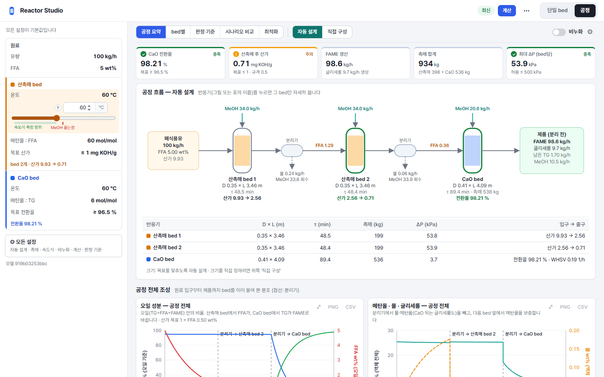 |

| ⚙ 모든 설정 (속도식 탭) | 단일 bed · 위치별 z |
| --- | --- |
| 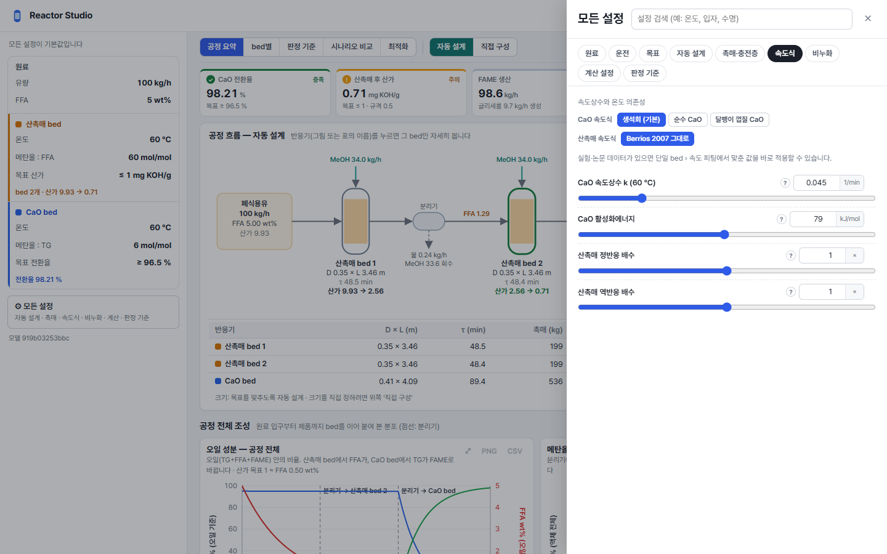 | 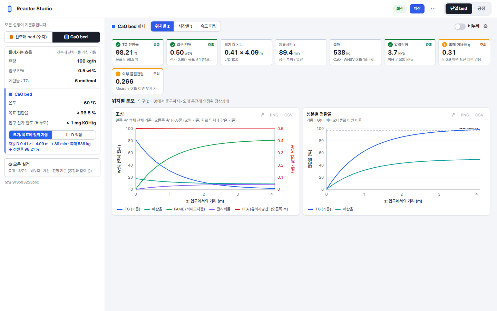 |

| 단일 bed · 시간별 t (시동) | 비누화 ON · 운전 시간별 촉매 소모 |
| --- | --- |
| 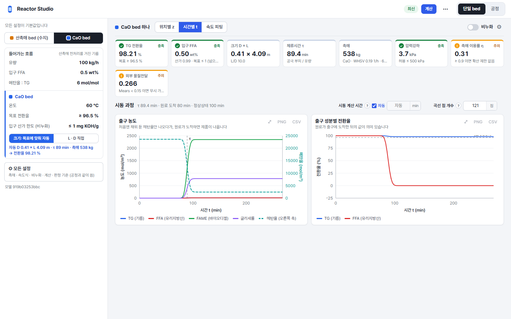 | 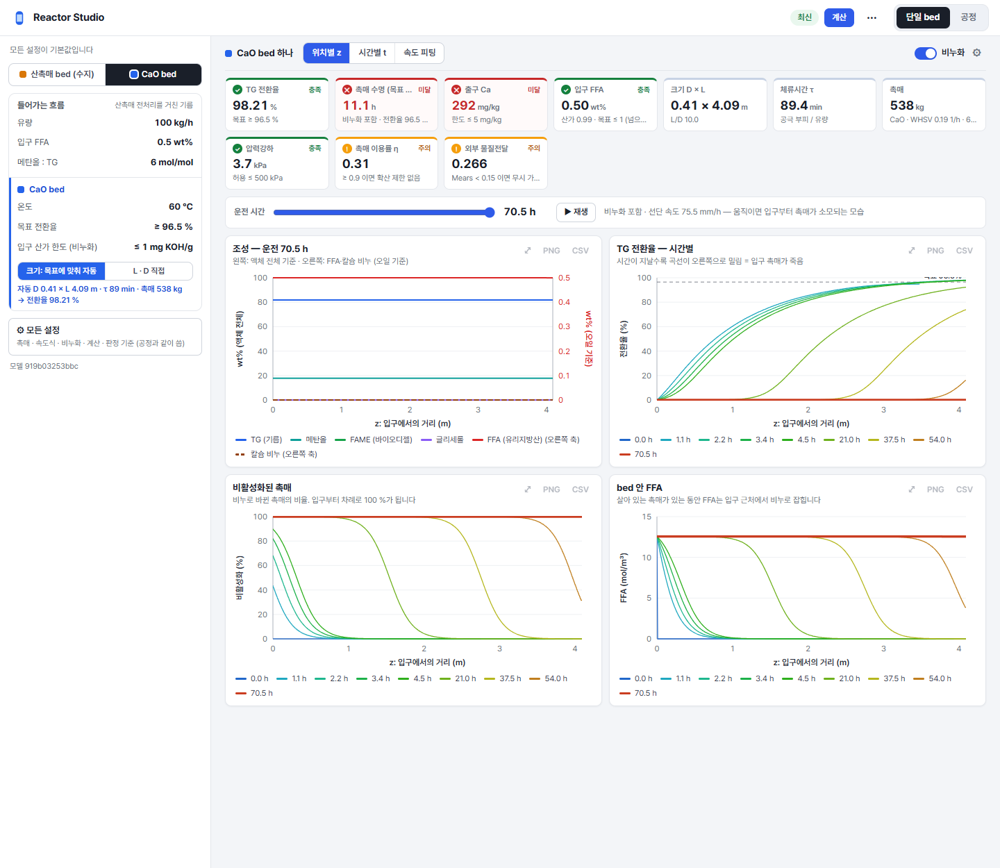 |

| 산촉매 bed 하나로 안 될 때 (평형 한계 안내) | 속도 피팅 (합성 예제) |
| --- | --- |
| 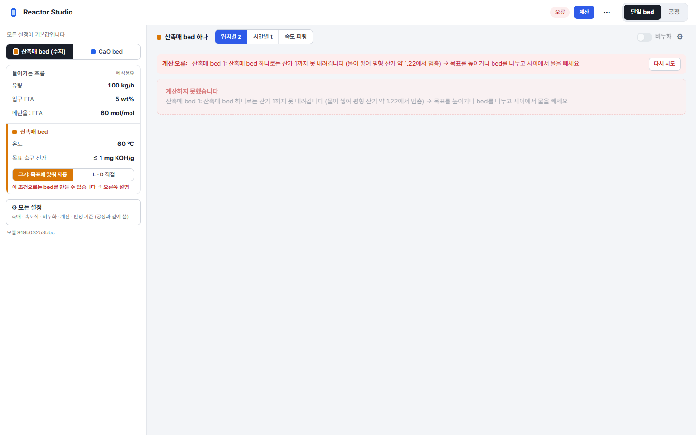 | 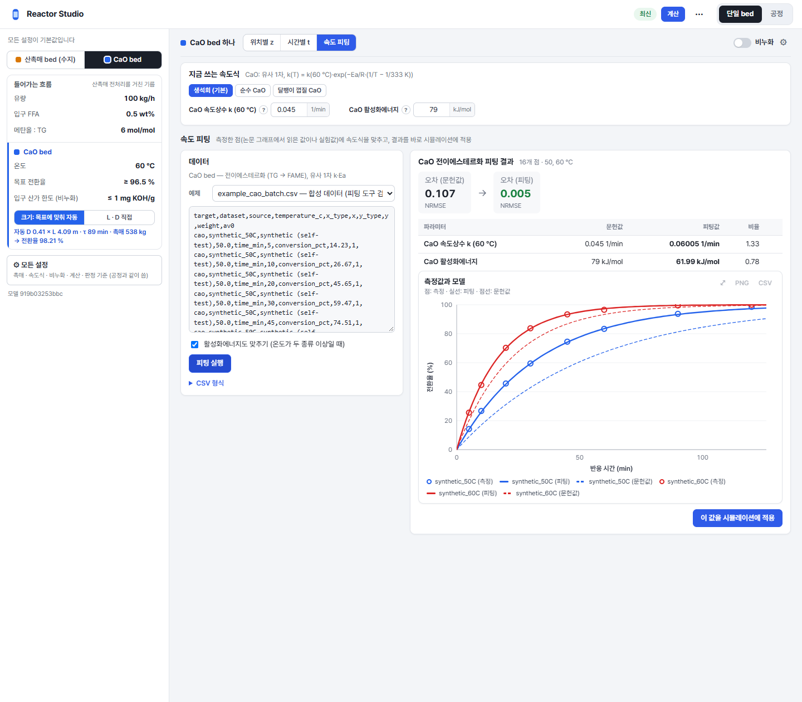 |

| 직접 구성 (공정 표) | 판정 기준 |
| --- | --- |
| 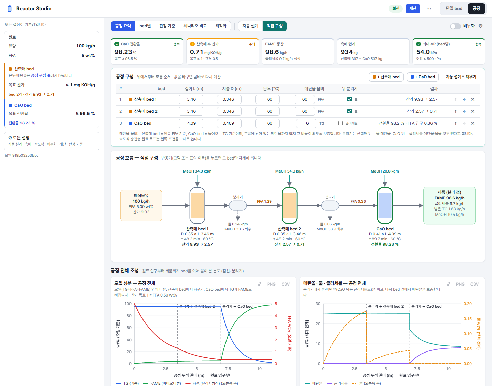 | 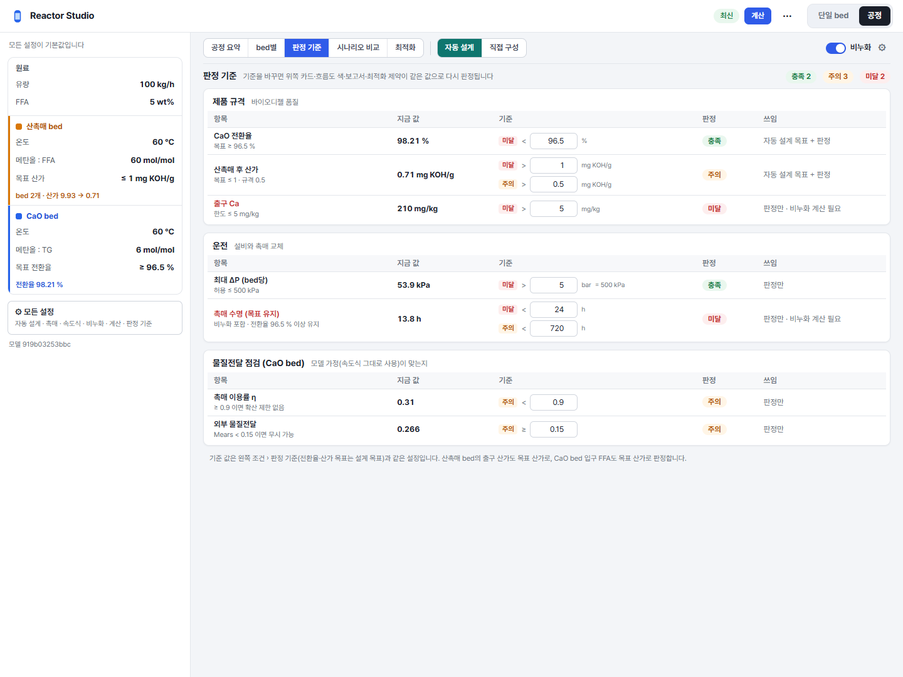 |

| 시나리오 비교 | 최적 조건 찾기 |
| --- | --- |
| 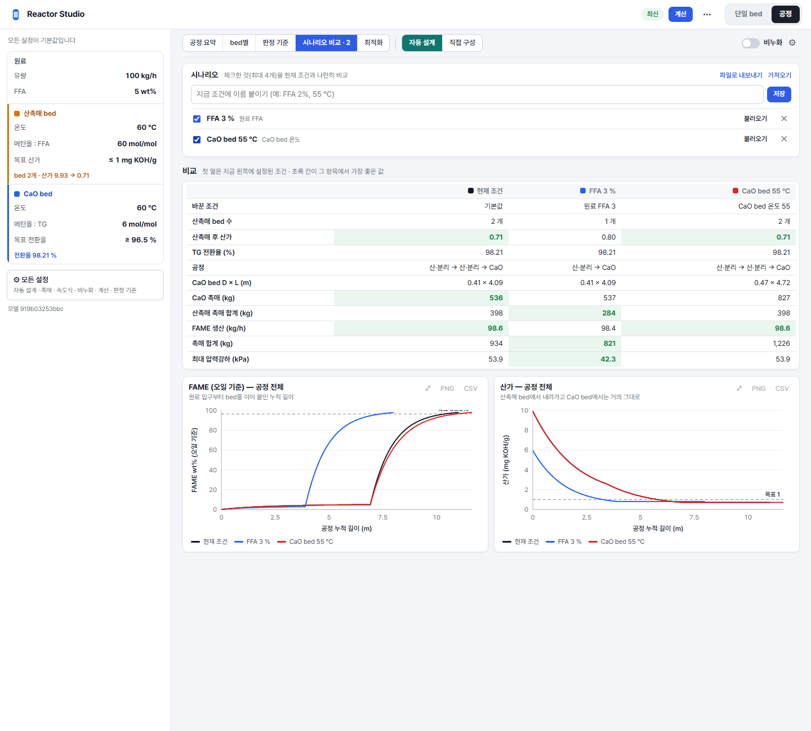 | 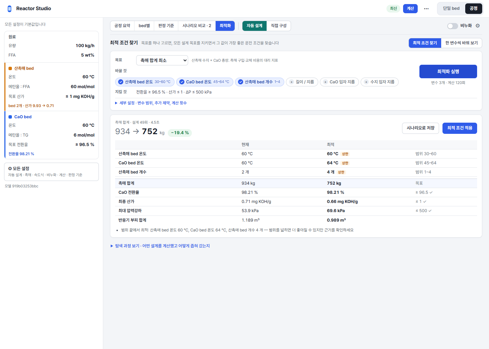 |

[한 변수씩 바꿔 보기](screenshots/13-sweep.png)

## 주요 기능 · 설계 의도

- **두 모드, 한 줄 보기 바:** 오른쪽 위 토글로 `단일 bed`(반응기 하나만 시험)와 `공정`(전체 공정)을 바꿉니다. 그 아래 segmented 버튼 한 줄에서 볼 내용(공정 요약·bed별·판정 기준·시나리오 비교·최적화 / 위치별 z·시간별 t·속도 피팅)을 고릅니다. 두 모드의 조건은 따로 저장됩니다.
- **왼쪽 속성 시트:** 원료·bed별 조건을 "이름 — 값" 한 줄로 보여 주고, 누르면 그 자리에서 숫자 입력·슬라이더·도움말이 펼쳐집니다. 슬라이더 아래에는 속도식 측정 범위와 메탄올 끓는점 같은 기준선을 표시합니다. 기본값과 다른 항목은 위쪽에 모아 "모두 되돌리기"로 되돌립니다. bed 그룹 끝에는 그 bed의 결과(bed 개수·산가 변화, 전환율)가 한 줄로 붙습니다.
- **⚙ 모든 설정:** 나머지 설정은 오른쪽 서랍의 탭(원료·운전·목표·자동 설계·촉매·충전층·속도식·비누화·계산 설정·판정 기준)과 검색으로 찾습니다. 문헌값은 preset 버튼으로 고릅니다.
- **KPI 카드:** 맨 위 카드마다 값·단위·기준과 충족/주의/미달 색 표시가 있습니다. 카드를 누르면 판정 기준 화면으로 가고, 판정 기준 표에서 기준값을 고치면 카드·흐름도·보고서·최적화 제약이 같이 바뀝니다.
- **살아 있는 흐름도:** 폐식용유 → 산촉매 bed → 분리기 → … → CaO bed → 제품을 SVG로 그리고, bed마다 크기·τ·입출구 값을, 분리기마다 빼낸 물·메탄올을 적습니다. 반응기를 누르면 그 bed의 상세로 갑니다.
- **직접 구성:** 공정을 표로 짭니다. bed 추가(산촉매/CaO), 순서 바꾸기, 뒤 분리기 체크, 행마다 계산 결과를 보여 주고 흐름도도 같은 구성으로 다시 그립니다.
- **오류를 이유와 함께:** 산촉매 bed 하나로 목표 산가에 못 가면(물 평형으로 약 1.22에서 멈춤) 빈 그래프 대신 이유와 해결 방법(목표 완화 또는 bed 분할 + 물 제거)을 보여 줍니다.
- **그래프 공통 도구:** 모든 그래프는 같은 SVG 차트 모듈로 그리며 확대(⤢)·PNG·CSV 내보내기, 마우스를 올리면 값 표시, 성분별 고정 색(`theme.js`)을 씁니다.
- **긴 계산:** 비누화(DAE)·최적화·sweep은 서버 작업으로 돌리고 진행 상태를 보여 주며, 결과는 조건별로 캐시해 같은 조건을 다시 열면 바로 나옵니다.
- **최적화 한 카드:** 목표(드롭다운) · 바꿀 것(변수 칩) · 지킬 것(제약 한 줄) 세 줄로 줄이고, 결과는 "현재 → 최적" 한 줄과 표, "적용"/"시나리오로 저장" 버튼으로 보여 줍니다. 범위 끝에 붙은 변수에는 `상한`/`하한` 표시를 붙입니다.

## Framework / library

| 역할 | 기술 |
| --- | --- |
| UI | 순수 HTML + CSS + JavaScript ES modules (빌드·번들러·외부 JS 라이브러리 없음) |
| 그래프·흐름도·로고 | 직접 작성한 SVG 렌더러 (`js/chart.js`, `js/flowsheet.js`) |
| 저장 | 브라우저 localStorage (조건, 보기, 시나리오) |
| 글꼴 | CSS에서 Pretendard → Malgun Gothic → 시스템 글꼴 순서로 지정. 글꼴 파일은 포함하지 않음 |
| 원본 앱의 서버 측 | Python 3.11 표준 `http.server` + numpy 1.26.2, scipy 1.16.3, CasADi 3.7.2 — 이 보관본에는 미포함 |
| 원본 앱의 창 | pywebview 6.2.1 + Windows Edge WebView2, PyInstaller 6.22.3로 exe 포장 — 이 보관본에는 미포함 |

## 보관 소스

`source/web/`에는 원본 폴더를 **바이트 그대로** 넣었습니다(원본이 CRLF). [.gitattributes](.gitattributes)가 줄바꿈 변환을 막습니다.

| 파일 | 역할 | 의존 |
| --- | --- | --- |
| [index.html](source/web/index.html) | 상단 바·메뉴·모드 토글·왼쪽 패널·보기 영역의 뼈대 | `css/studio.css`, `js/main.js` |
| [css/studio.css](source/web/css/studio.css) | 전체 스타일. 색은 `:root` 변수(`--accent` #2f5be9 등) | 없음 |
| [js/chart.js](source/web/js/chart.js) | SVG 선·점 그래프: 보조 y축, 점선 구간, 범례, 마우스 값 표시, 확대·PNG·CSV | `util.js`만 |
| [js/flowsheet.js](source/web/js/flowsheet.js) | 공정 흐름도 SVG | `util.js`만 |
| [js/settings.js](source/web/js/settings.js) | 왼쪽 속성 시트, ⚙ 모든 설정 서랍, preset 버튼 | `store.js`, `util.js` |
| [js/kpis.js](source/web/js/kpis.js) | 위쪽 KPI 카드 줄 | `store.js`, `views/common.js` |
| [js/train.js](source/web/js/train.js) | 직접 구성 공정 표 | `api.js`, `store.js` |
| [js/store.js](source/web/js/store.js) | 상태 + 작은 event bus, URL hash와 localStorage 동기화 | `util.js` |
| [js/main.js](source/web/js/main.js) | 시작, 계산 요청, 화면 전환 | 모든 모듈 |
| [js/views/](source/web/js/views/) | 보기별 화면: 공정 요약·bed·판정 기준·시나리오 비교·최적화·속도 피팅 | 위 모듈들 |
| [js/api.js](source/web/js/api.js) | 서버 API 호출(`/api/spec`, `/api/steady`, `/api/transient`, `/api/deactivation`, `/api/fit`, `/api/optimize`, `/api/sweep` …) | 원본 Python 서버 |

**재사용하려면:** `chart.js`는 `util.js`와 함께 복사하면 다른 화면에서 바로 씁니다(`createChart(options)`가 DOM 요소를 돌려줌, 옵션 형식은 파일 첫 주석). `flowsheet.js`도 `util.js`만 있으면 됩니다. 속성 시트(`settings.js`)는 `store.js`의 파라미터 정의(서버 `/api/spec`이 주는 이름·범위·단위·도움말)에 묶여 있어, 다른 앱에서는 그 정의를 같은 모양으로 넘겨야 합니다.

## 실행

원본 프로젝트에서만 실행됩니다. 이 폴더만으로는 계산 서버가 없어 "서버에 연결할 수 없습니다" 화면에서 멈춥니다.

```sh
# 원본 프로젝트 폴더에서 (numpy, scipy, casadi 필요)
python reactor_studio/server.py --port 8780
# 브라우저: http://127.0.0.1:8780/
```

캡처 재현: 서버를 켠 뒤 `REACTOR_STUDIO_URL=http://127.0.0.1:8780/ python preview/scripts/capture.py` (Playwright + Edge). 스크립트는 새 브라우저 context에서 localStorage를 비우고 시작하므로 항상 기본 조건에서 찍습니다.

## 확인한 동작

- 2026-10-28: 13개 화면을 실행해 캡처하고 각 이미지를 열어 글자·잘림·개인정보 노출 여부를 확인.
- 2026-10-28: 비누화 계산(서버 작업, 70.5 h까지), 속도 피팅, 시나리오 2개 비교, 최적화(계산 예산 120회, 설계 49개 계산 후 결과 표시), CaO bed 온도 sweep 15점이 화면에서 끝까지 완료됨을 확인.
- 원본 프로젝트의 자동 테스트(UI·서버 42개, 모델 37개)는 이 snapshot의 원본에서 통과한 상태입니다. 이 아카이브에서 다시 실행한 것은 아닙니다.

## 미확인 · 제약

- 다크 모드와 좁은 폭(모바일) 레이아웃은 없습니다. CSS에는 980px 이하에서 왼쪽 패널을 ☰ 버튼으로 여닫는 규칙이 있지만 캡처·확인하지 않았습니다.
- 단일 bed 화면에서 KPI 카드가 7–10개라 두 줄로 넘어가고, 일부 카드의 보조 설명이 "…"로 잘립니다(04·06번). 실제 UI 동작 그대로입니다.
- 전환율 그래프의 목표선 이름표("목표 96.5 %")가 그래프 위쪽 끝에 붙어 일부 가려집니다(04·06·11번).
- 메뉴의 내보내기(Markdown·CSV·JSON)와 exe 창(pywebview)의 저장 대화상자는 캡처하지 않았습니다.
- 소스는 UI 부분만이라 단독 실행되지 않습니다.

## 참고와 권리

- 참고한 UI: 없음 (Reference UI 항목 연결 없음)
- 직접 작성한 범위: 보관한 웹 UI 21개 파일과 캡처 재현 스크립트
- 외부 코드·아이콘·글꼴: 외부 코드·아이콘 없음. 화면의 글꼴은 Pretendard(SIL OFL 1.1, 캡처 PC에 설치된 것)이며 파일은 복사하지 않았습니다.
- 내 코드의 라이선스: 미정(UNSPECIFIED). 공개 재사용을 허용한다는 뜻이 아닙니다.
- 상세: [권리 기록](licenses/README.md)

## 변경 이력

| 날짜 | revision | 변경 | 확인 |
| --- | --- | --- | --- |
| 2026-10-28 | local-2026-10-28-model-919b03253bbc | 최초 등록: 실제 화면 13장, 웹 UI 소스 전체(21개 파일), 캡처 재현 스크립트 | 화면 캡처·소스 해시 기록 완료, 내보내기·좁은 폭 미확인 |
